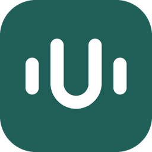
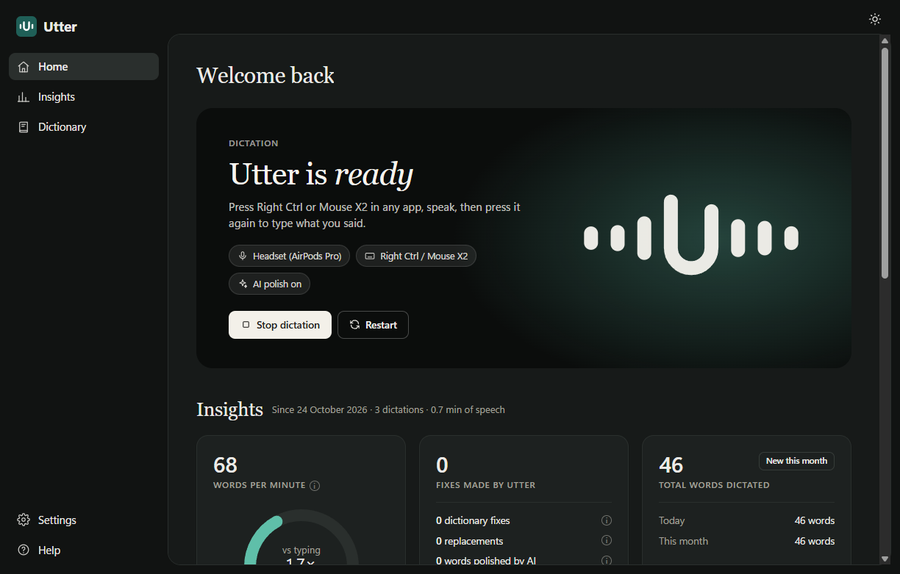
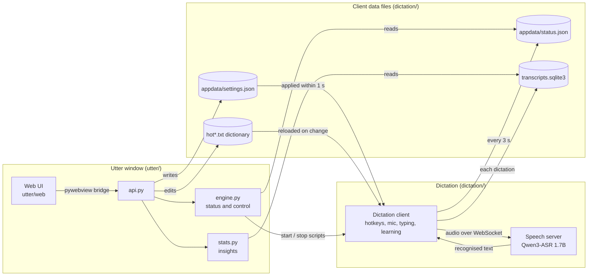

  

<h1 align="center">Utter</h1>

  Private, on-device dictation for Windows. 
  Press a shortcut in any app, speak, and the text is typed where your cursor is. It learns your words as you go.

  

---

## What it is

Utter is dictation that runs on your own Windows 10 or 11 PC. Press Right Ctrl (or your mouse's side button), talk, and press it again: your words are typed into whatever app has focus. Speech recognition runs locally with Qwen3-ASR 1.7B, so your audio never leaves your PC.

It has two parts in this repo:

- **The dictation client** (`dictation/`) runs in the background. It records while you hold or toggle the shortcut, sends the audio to the speech model on your PC, corrects the result and types it.
- **The Utter window** (`utter/`) shows what the client is doing and lets you change it.

## What it's for

Anything you would otherwise type: messages, email, documents, notes, prompts for AI tools, comments in your code editor. For example, you say *"um, so can you send the deck to cloud before Friday, no wait, Thursday"* and Utter types *"Can you send the deck to Claude before Thursday?"*

- **Learns from your corrections.** After a dictation, Utter watches the text field for 90 seconds. If you fix a misheard name ("Brightloop" for "bright loop"), the fix goes into your dictionary. It only learns distinctive words (names, brands, acronyms) that still sound like what was heard, and skips terminals and password managers.
- **AI dictionary review (optional).** When you are idle, a stronger model reads batches of new dictations through your Codex CLI login and learns misheard terms ("codecs" for "Codex"). A fix is accepted only if it quotes the transcript and clears a confidence threshold. This sends dictation text to OpenAI, so it is off until you turn it on in Settings > Dictation.
- **Dictionary matched by sound.** Words in your dictionary replace sound-alike mistakes ("git hub" becomes "GitHub"); replacement rules handle fixed phrases, spoken email addresses and filler words.
- **AI polish (optional).** A local model (LM Studio or Ollama) cleans up long dictations: removes fillers and false starts, fixes punctuation, and keeps your words. A guard falls back to the original text if the model starts answering instead of editing.

- **Use a stronger PC's speech engine over Tailscale.** A laptop can run only the client and send audio to the speech server on your desktop.
- **Insights**: this month's words, your speaking speed against your typing, time saved, what Utter corrected and learned, words per day and the apps you dictate into.
- **Notetaker**: records a meeting (your microphone as you, what the PC plays as everyone else), transcribes it on the same local engine, then writes a title, overview, key points and next steps. Audio is never saved. Utter can offer to start it when a Google Meet, Zoom or Teams call begins.
- **MCP**: Codex, Claude Code, Pi or LM Studio can search what you dictated and what was said in your meetings, read-only.

## Nebius Token Factory + NVIDIA Nemotron

Nebius is an optional provider for the existing OpenAI-compatible model path. Set `NEBIUS_API_KEY` in the environment, then choose `provider = 'nebius'` in `dictation/LLM/default.py` for AI polish. That role defaults to `nvidia/nvidia-nemotron-3-nano-30b-a3b` (override with `NEBIUS_NANO_MODEL`): Nano is the smaller, efficient choice for frequent dictation cleanup. For meeting notes, choose **Nebius Token Factory (Nemotron Ultra)** under Settings > Notetaker; it uses `nvidia/Nemotron-3-Ultra-550b-a55b` (override with `NEBIUS_ULTRA_MODEL`) for deeper reasoning. Meeting transcripts are sent to Nebius when selected. The default Notetaker choice remains Codex.

The model IDs follow Nebius's [Nano cookbook](https://github.com/nebius/token-factory-cookbook/blob/main/models/nemotron/nemotron3-nano-30b.md), [Ultra cookbook](https://github.com/nebius/token-factory-cookbook/blob/main/models/nemotron/nemotron3-ultra-550b-a55b.md), and [Nemotron model catalog](https://nebius.com/services/token-factory/models/nvidia-nemotron-models-inference). Nebius documents the OpenAI-compatible endpoint at `https://api.tokenfactory.nebius.com/v1/`.

**What changed during the hackathon:** Utter gained Nebius as one provider beside its existing choices. Dictation can use Nemotron Nano for quick polish, and the Notetaker can use Nemotron Ultra for meeting notes. The rest of Utter remains the same app.

## Evidence

- **254 offline tests** cover the window (86), the dictation client (148) and the bundled diagnosis skill (20): settings, the dictionary formats, learning from edits, the AI polish guard, insights, the Notetaker and the MCP tools. They need no speech server.
- **The English dictionary matcher** was checked once, when the Chinese-language branch was removed: it gave the same results as before on 65 recorded matching cases. The main cases are kept as a test.
- **Limits:** the tests do not use a microphone or type into real apps. Speech accuracy depends on Qwen3-ASR, your microphone and your accent, and has not been measured for this repo.

## How it is designed

The window and the client share files, not code paths. Utter imports the client's own modules for every file it reads or writes (`utter/dictation.py`), so each format has one definition. The only file Utter owns is the Notetaker's store, `%APPDATA%\Utter\notetaker.sqlite3`. For meetings, Utter talks to the speech server directly, with the same WebSocket messages the client sends.

For example, when you switch on **Dictation sounds**, the page calls `api.set_setting`, which uses the client's `util/app_settings.py` to write `appdata/settings.json`. The client checks that file every second, turns sounds on, and reports the new state in `appdata/status.json`, which Utter reads for the banner.

| Layer | Where | Responsibility |
|---|---|---|
| Presentation | `utter/web/` | Home, settings, Notetaker; plain HTML, CSS and JavaScript with no build step |
| Bridge | `utter/api.py` | One method per page action; returns data or `{'error': ...}` |
| Application | `utter/engine.py`, `utter/stats.py` | Is dictation running, start/stop/restart, launch at login; insights from the archive |
| Notetaker | `utter/meeting.py`, `utter/summary.py`, `utter/codex.py`, `utter/notes.py` | Record mic and speaker loopback, transcribe, write notes, store notes and contacts |
| Connectors and MCP | `utter/google_calendar.py`, `utter/mcp_server.py`, `utter/lmstudio.py`, `utter/agents.py`, `utter/local_state.py` | Calendar sign-in, read-only MCP tools, LM Studio entry, agent status; secrets in Windows Credential Manager |
| Dictation client | `dictation/` | Shortcuts, recording, dictionary correction, AI polish, typing, learning, the transcript archive |

Product decisions are in [docs/decision-surfaces.md](docs/decision-surfaces.md). The logo is drawn by `assets/make_icon.py`. The launch page in `site/` is published to GitHub Pages by `.github/workflows/pages.yml`. `skills/utter-stabilise/` is an agent skill for diagnosing dropped or silent dictation.

## Privacy

| What | Where it goes |
|---|---|
| Speech recognition | On your PC (or your own PC over Tailscale). Audio is never uploaded. |
| AI polish | The model you configure; local by default. |
| AI dictionary review | OpenAI, through your Codex CLI login, when switched on. |
| Meeting notes | OpenAI through the Codex app server by default, or your local model. |
| MCP | Whatever the connected agent's model provider is; LM Studio stays local. |

## License

MIT, see [LICENSE](LICENSE). The dictation client is a fork of [CapsWriter-Offline](https://github.com/HaujetZhao/CapsWriter-Offline) by Haujet Zhao (MIT); speech recognition uses Qwen3-ASR. The common-word list `dictation/util/hotword/common_en.txt` is derived from [wordfreq](https://github.com/rspeer/wordfreq) word frequencies by Robyn Speer and is under CC BY-SA 4.0.

---

To install, paste this into a coding agent (Claude Code, Codex) on your PC:

> Install Utter on this Windows PC. Follow https://github.com/sz-747/utter-public/blob/main/INSTALL.md step by step: clone the repo, set up the Python environment, download the speech model, and create the shortcuts. Ask me before anything that needs admin rights. Finish with the checks at the end of the guide and tell me what passed.

**[AGENTS: READ THIS TO INSTALL, CONFIGURE, RUN AND TEST UTTER](INSTALL.md)**
