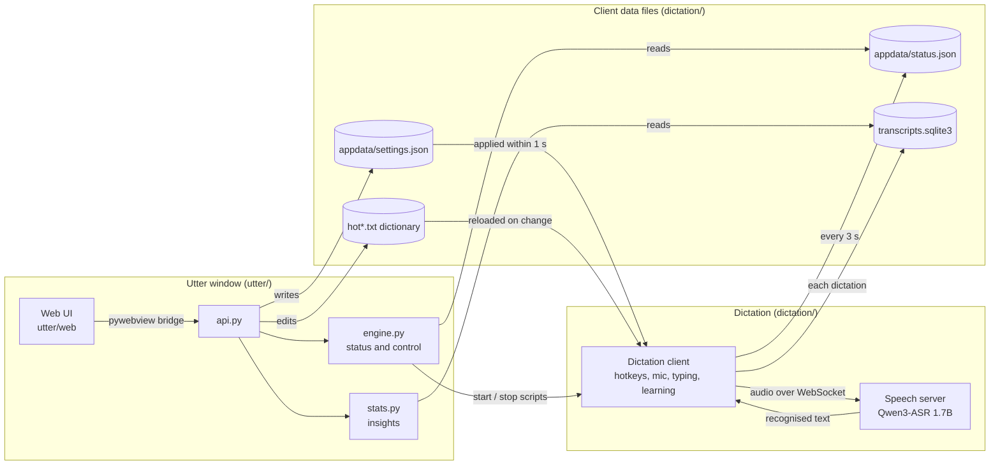

<p align="center">
  
</p>

<h1 align="center">Utter</h1>

<p align="center">
  Private, on-device dictation for Windows.<br>
  Press a shortcut in any app, speak, and the text is typed where your cursor is. It learns your words as you go.
</p>

<p align="center">
  
</p>

---

## What is Utter?

Utter has two parts in this repo:

- **The dictation client** (`dictation/`) runs in the background. It records while you hold or toggle a shortcut, sends the audio to a speech model on your PC, corrects the result and types it into whatever app has focus.
- **The Utter window** (`utter/`) shows what the client is doing and lets you change it.

Speech recognition runs locally with Qwen3-ASR 1.7B, so audio never leaves your PC.

### Features

- **Learns from your corrections.** After a dictation, Utter watches the text field for 90 seconds. If you fix a misheard name ("Brightloop" for "bright loop"), the fix goes into your dictionary. It only learns distinctive words (names, brands, acronyms) that still sound like what was heard, and skips terminals and password managers.
- **AI dictionary review (optional).** When you are idle, a stronger model reads batches of new dictations through your Codex CLI login and learns misheard terms ("codecs" for "Codex"). A fix is accepted only if it quotes the transcript and clears a confidence threshold. This sends dictation text to OpenAI, so it is off until you turn it on in Settings > Dictation.
- **Dictionary matched by sound.** Words in your dictionary replace sound-alike mistakes ("git hub" becomes "GitHub"); replacement rules handle fixed phrases, spoken email addresses and filler words.
- **AI polish (optional).** A local model (LM Studio or Ollama) cleans up long dictations: removes fillers and false starts, fixes punctuation, and keeps your words. A guard falls back to the original text if the model starts answering instead of editing.
- **Use a stronger PC's speech engine over Tailscale.** A laptop can run only the client and send audio to the speech server on your desktop. See [Remote dictation](#remote-dictation-over-tailscale).
- **Insights**: this month's words, your speaking speed against your typing, time saved, what Utter corrected and learned, words per day and the apps you dictate into.
- **Notetaker**: records a meeting (your microphone as you, what the PC plays as everyone else), transcribes it on the same local engine, then writes a title, overview, key points and next steps. Audio is never saved. Utter can offer to start it when a Google Meet, Zoom or Teams call begins.
- **MCP**: Codex, Claude Code, Pi or LM Studio can search what you dictated and what was said in your meetings, read-only.

---

## Install

Utter needs Windows 10 or 11 (64-bit), Python 3.11, Git and about 3 GB of disk space. A GPU helps the speech model but is not required.

Follow [INSTALL.md](INSTALL.md), or paste this into a coding agent (Claude Code, Codex) on the PC:

> Install Utter on this Windows PC. Follow https://github.com/sz-747/utter-public/blob/main/INSTALL.md step by step.

In short:

```powershell
git clone https://github.com/sz-747/utter-public.git utter
cd utter
py -3.11 -m venv .venv
.venv\Scripts\python.exe -m pip install -r requirements.txt
```

Then download the speech server and model into `dictation\internal\runtime\` (INSTALL.md step 3).

## Configure

- **Settings in the window**: shortcuts, microphone, sounds, muting other apps, learning, AI review, AI polish and output.
- **Your dictionary**: `dictation\hot.txt` (words), `dictation\hot-rule.txt` (replacement rules) and `dictation\hot-rectify.txt` (examples for AI polish). They are created from the `*.example.txt` files the first time the client runs, and Git ignores them. You can also edit words in the window's Dictionary.
- **Everything else**: `dictation\config_client.py` (defaults) and `dictation\LLM\default.py` (the AI polish model and prompt).

### AI polish

AI polish needs a local model server. In `dictation\LLM\default.py`, point `api_url` and `model` at LM Studio (`http://127.0.0.1:1234/v1`, the id from `lms ls`) or Ollama (`provider = 'ollama'`). Use `127.0.0.1`, not `localhost`: on Windows, `localhost` adds about 2 seconds to every request. Then switch it on in Settings > Dictation.

### Remote dictation over Tailscale

A weaker machine can use another PC's speech server:

1. On the PC with the speech server, keep the server on `127.0.0.1` and share the port on your tailnet: `tailscale serve --bg --tcp 6016 tcp://127.0.0.1:6016`.
2. On the laptop, install Utter but skip the speech server download. In `dictation\config_client.py`, set `addr` to the PC's Tailscale name (for example `'desktop.your-tailnet.ts.net'`).

With no local server installed, Utter starts only the client, and the banner names the PC it is using.

### MCP for coding agents

Add a server named `utter` to each agent's MCP config that runs, from this folder:

```
.venv\Scripts\python.exe -m utter.mcp_server
```

Set `UTTER_MCP_CLIENT` (for example `codex` or `claude`) in that entry's environment so Utter shows each agent's last use. LM Studio can be added from Settings > MCP.

## Run

```powershell
utter.cmd
```

Opening Utter starts dictation if it is off (Settings > System can turn that off). Closing the window leaves dictation running. Press Right Ctrl (or mouse button X2), speak, and press it again.

To run dictation without the window: `dictation\start-dictation.cmd`, and `dictation\stop-dictation.cmd` to stop it.

## Test

```powershell
.venv\Scripts\python.exe -m unittest discover -s tests -t .
cd dictation; ..\.venv\Scripts\python.exe -m unittest discover -s util -p "test_*.py" -t .; cd ..
.venv\Scripts\python.exe -B -m unittest discover -s skills/utter-stabilise/tests
```

The tests run offline and need no speech server. Two of them touch Windows itself and clean up after themselves: one copies text to the clipboard and puts your previous clipboard back, and one stores and deletes a test entry (`Utter/unit-test-secret`) in Windows Credential Manager.

---

## How it fits together

The window and the client share files, not code paths. Utter imports the client's own modules for every file it reads or writes (`utter/dictation.py`), so each format has one definition. The only file Utter owns is the Notetaker's store, `%APPDATA%\Utter\notetaker.sqlite3`. For meetings, Utter talks to the speech server directly, with the same WebSocket messages the client sends.



For example, when you switch on **Dictation sounds**, the page calls `api.set_setting`, which uses the client's `util/app_settings.py` to write `appdata/settings.json`. The client checks that file every second, turns sounds on, and reports the new state in `appdata/status.json`, which Utter reads for the banner.

| Layer | Where | Responsibility |
|---|---|---|
| Presentation | `utter/web/` | Home, settings, Notetaker; plain HTML, CSS and JavaScript with no build step |
| Bridge | `utter/api.py` | One method per page action; returns data or `{'error': ...}` |
| Application | `utter/engine.py`, `utter/stats.py` | Is dictation running, start/stop/restart, launch at login; insights from the archive |
| Notetaker | `utter/meeting.py`, `utter/summary.py`, `utter/codex.py`, `utter/notes.py` | Record mic and speaker loopback, transcribe, write notes, store notes and contacts |
| Connectors and MCP | `utter/google_calendar.py`, `utter/mcp_server.py`, `utter/lmstudio.py`, `utter/agents.py`, `utter/local_state.py` | Calendar sign-in, read-only MCP tools, LM Studio entry, agent status; secrets in Windows Credential Manager |
| Dictation client | `dictation/` | Shortcuts, recording, dictionary correction, AI polish, typing, learning, the transcript archive |

Product decisions are in [docs/decision-surfaces.md](docs/decision-surfaces.md). The logo is drawn by `assets/make_icon.py`. The launch page in `site/` is published to GitHub Pages by `.github/workflows/pages.yml`. `skills/utter-stabilise/` is an agent skill for diagnosing dropped or silent dictation.

## Privacy

| What | Where it goes |
|---|---|
| Speech recognition | On your PC (or your own PC over Tailscale). Audio is never uploaded. |
| AI polish | The model you configure; local by default. |
| AI dictionary review | OpenAI, through your Codex CLI login, when switched on. |
| Meeting notes | OpenAI through the Codex app server by default, or your local model. |
| MCP | Whatever the connected agent's model provider is; LM Studio stays local. |

## License

MIT, see [LICENSE](LICENSE). The dictation client is a fork of [CapsWriter-Offline](https://github.com/HaujetZhao/CapsWriter-Offline) by Haujet Zhao (MIT); speech recognition uses Qwen3-ASR.
